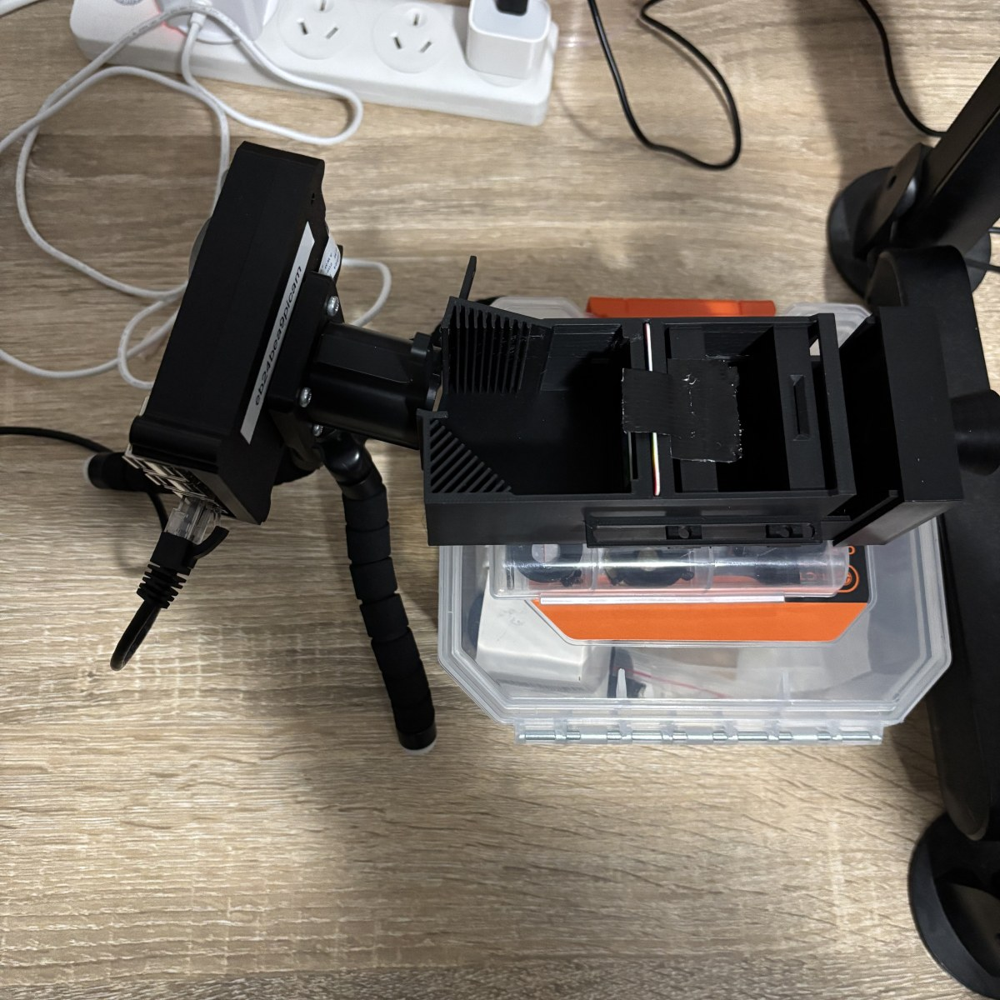
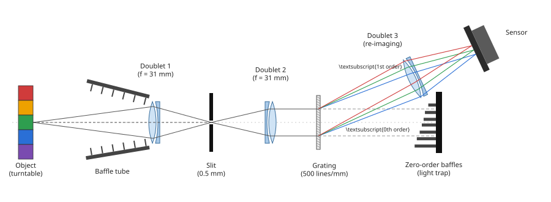

# MECH5720 2026 — Rotational Pushbroom Hyperspectral Imager Built from a Pi Camera and a Turntable

A low-cost slit spectrometer on a Raspberry Pi camera images one vertical line
of an object at a time while a free-running turntable rotates the object. The
lines are stitched by angle into a 360° hyperspectral panorama: a cube of
**azimuth × height × spectrum**. The turntable has no position sensor and its
speed labels are wrong, so the rotation period is recovered from the recorded
images themselves.

The accompanying report carries the argument and the results. This repository
carries what you need to build the imager, capture with it, and regenerate the
key figure.

```
step_files/     CAD (STEP) of every 3D-printed part
images/         build photo and optical schematic used in this README
scripts/        capture, reconstruction, experiment and figure scripts (run these)
  hsi/          shared library the scripts use
viewer/         optional live camera viewer (imgui)
results/
  figures/      the paper's figures, as PNG
  data/         the key numerical results behind them (JSON / CSV)
```

Captures and dark frames are written to `captures/` and `calibration/` as you
go. They are large and specific to one optical setup, so they are not part of
the repository.

<p align="center">
  
  
</p>

## 1. Parts

Every 3D-printed part needed to reconstruct the imager is included in
[`step_files/`](step_files/) as STEP files:

| File | Part |
|---|---|
| `carrier body.step` | Main housing: rails for the slit and collimator, grating opening, zeroth-order light trap |
| `front optical baffle - Part 2.step` | Detachable baffle tube in front of the collecting doublet |
| `slit holder - Part 1.step` | Slit carrier (slides on the rails) |
| `collimator holder - Part 1.step` | Collimating-doublet carrier (slides on the rails) |
| `grating holder V2 - Part 1.step` | Fixed grating mount |
| `PiCam parts - Default v6-1__Body1.step` | Adaptor locating the re-imaging lens holder and Pi camera against the housing |

The other components:

| Component | Specification |
|---|---|
| Collecting, collimating and re-imaging lenses | 3 × achromatic doublet, f = 31 mm (laboratory kit) |
| Slit | ≈ 0.5 mm wide (laboratory kit) |
| Diffraction grating | 500 lines/mm transmission grating (laboratory kit) |
| Re-imaging lens holder | Laboratory-kit lens holder, modified to take the printed adaptor |
| Camera | Raspberry Pi camera (OV5647 sensor) on a Raspberry Pi |
| Turntable | Motorised display turntable, three speed settings, no position output |
| Light | Bright white lamp(s) aimed at the object |
| Other | Black plastic sheet (covers the open-top housing), lens cap, white paper (white reference), red/green/blue cellophane, black tape and white card (knife edge) |

## 2. Build

The optics follow a conventional slit spectrometer (schematic above).

1. **Print the parts** in `step_files/` in black (or matt-black painted) material so
   the inside of the housing absorbs stray light.
2. **Fit the collecting doublet** at the housing entrance and attach the
   detachable baffle tube in front of it. The tube excludes light from outside
   the field of view.
3. **Fit the slit and the collimating doublet** on the rails behind the
   collecting doublet. Both slide along the optical axis.
4. **Fit the grating** in its fixed mount. Because it is fixed, the zeroth and
   first diffraction orders leave at known angles: the zeroth order goes into
   the printed light trap, and the first order (about 11.5°–20.5° for
   400–700 nm) leaves through the opening in the housing.
5. **Fit the re-imaging doublet** in its lens holder with the printed adaptor,
   which locates it against the housing so it returns to the same place every
   time it is removed. Mount the Pi camera behind it.
6. **Place the turntable** so the object's centre is about 300 mm from the
   collecting doublet, and light the object from the front.
7. **Focus**, using the live viewer or repeated `snapshot.py` runs (below):
   - slide the slit until the object is sharp on it;
   - then slide the collimating doublet until the spectrum on the sensor is sharp.
8. **Cover the whole apparatus** with the black sheet before every
   measurement; the housing is open at the top.

With the camera mounted as built, the spectrum runs along the sensor so that,
after the scripts reorient it, frames are **540 rows along the slit × 960
spectral columns, blue at column 0**.

## 3. Capture procedure

Each step is one command, so you can change the setup between them.

```
python take_dark.py      # lens capped, room dark: dark frame -> calibration/dark.npz
python snapshot.py       # lens open, object lit: check the light before scanning
python scan.py           # turntable running: 70 s scan, live preview, then the panorama
```

| Script | What it does |
|---|---|
| `take_dark.py` | Mean of 20 frames with the lens capped → `calibration/dark.npz`. Every other script subtracts it automatically. |
| `snapshot.py` | A few still frames, with a plot of the spectrum at several heights. Use it to check that light reaches the whole slit, is bright enough, and doesn't saturate. |
| `scan.py` | Captures for 70 s (at least 2 turns at any speed), draws the panorama live, then reconstructs it. `--experiment NAME --tag TAG` sets the output folder `captures/NAME/<time>_TAG/`. |
| `reconstruct.py` | Scan → `cube.npz` + `panorama.png` + `bands.png`. Measures the turntable period from the scan itself (period search, then a turn-to-turn fit) and merges all turns. `scan.py` runs it automatically; rerun it by hand to redo a scan. |

Defaults (set automatically when a script connects): **1920×1080 raw Bayer,
100 ms exposure, 8× analogue gain**, with each 2×2 Bayer cell summed into one
value. `--exposure-us` and `--gain` override them. If you change them, retake
the dark frame at the same settings.

### Experiments

Each experiment writes to `captures/<experiment>/<time>/`, including a
`results.json` and its plots.

| Experiment | Setup | Commands |
|---|---|---|
| Turntable reconstruction | Object on the turntable, one scan per speed setting | `scan.py --experiment speed_comparison --tag setting1` (then `setting2`, `setting3`); `exp_consistency.py <scan>` for each; `exp_speed_comparison.py ../captures/speed_comparison` |
| Processing choices | Uses the scans above (no hardware) | `exp_processing_comparisons.py` |
| Sensor noise and exposure | Object still and lit, then lens capped | `exp_exposure_sweep.py --phase light`, then `exp_exposure_sweep.py --phase dark --run <folder>` |
| Spectral repeatability | Turntable stopped, object still | `exp_repeatability.py --n 50` |
| Spatial resolution (LSF) | Straight black edge on an evenly lit white card, at right angles to the slit | `exp_line_spread.py dark` (lens capped), `exp_line_spread.py edge middle`, `exp_line_spread.py analyse` |
| Deconvolution | Uses a scan and an LSF from the same setup (no hardware) | `exp_deconvolution.py --scan <scan> --edge <edge .npz>`, `--method rl` (default) or `--method wiener --nsr 0.01` |
| Colour-filter response | White card lit by the lamp; each cellophane sheet over the lamp in turn | `cal_cellophane.py dark`, `white`, `blue`, `green`, `red`, then `analyse` |
| Unlabelled clustering | Scan of an object with several coloured materials | `exp_discrimination.py <scan> --auto 6` |
| Material discrimination | See below | |

**Material discrimination** (real vs imitation fruit). 

```
python take_dark.py --exposure-us 50000                       # lens capped
# for each of real_lemon, fake_lemon, real_apple, fake_apple, centred on the turntable:
python snapshot.py --experiment material_comparison --tag real_lemon --exposure-us 50000
python scan.py     --experiment material_comparison --tag real_lemon --exposure-us 50000
# white paper (round a can) at the same position, as the reflectance reference:
python snapshot.py --experiment material_comparison --tag white --exposure-us 50000
python exp_material_comparison.py              # from the scans -> captures/material_comparison/analysis/
python exp_material_comparison.py --snapshots  # the same comparison from one still frame per object
```

Any `real_X` / `fake_X` tags pair up. The analysis divides each object by the
white reference (relative reflectance), splits it into twelve 30° sectors,
and reports spectral angles within and between objects and leave-one-sector-out
classification accuracy. It does this for the full spectrum and for three
broad bands emulating a colour camera.

## 4. Regenerating the key figure

The key figure is the relative reflectance of the real and imitation lemon and
apple (`results/figures/material.png`). It is regenerated from the analysis
results kept in this repository,
`results/data/material_comparison/results.json`:

```
cd scripts
python make_report_figures.py material          # -> results/figures/material.png
```

If you have captured your own scans, `exp_material_comparison.py` writes
`captures/material_comparison/analysis/results.json`, and the same command
then uses that file instead. `make_report_figures.py` with no arguments
regenerates every figure. The figures other than `material` need the raw
captures of the corresponding experiments.

## 5. Results

`results/figures/` holds the paper's figures, plus two deconvolution examples:

| Figure | Shows |
|---|---|
| `snapshot.png` | One frame of a white card: the sensor image and the spectrum at four heights |
| `snr.png` | Signal-to-noise ratio against signal for the exposure and gain sweeps |
| `cellophane_transmission.png`, `cellophane_methods.png` | Cellophane filter transmission, and the measured vs shifted-green pixel responses |
| `lsf.png` | Line spread function along the slit, whole spectrum and per third |
| `panoramas.png`, `merging.png` | Panoramas at the three turntable speeds, and one turn vs all turns merged |
| `material.png` | Relative reflectance of real and imitation lemon and apple (the key figure) |
| `deconvolution_richardson_lucy.png`, `deconvolution_wiener.png` | One turn before and after deconvolution along the slit |

`results/data/` holds the numbers behind them, one folder per experiment:
`speed_comparison/`, `processing_comparisons/`, `exposure_sweep/`,
`line_spread/`, `cellophane/`, `material_comparison/` (scans),
`material_comparison_snapshot/` (single frames) and `deconvolution/`.

## 6. Known pitfalls

- **If the camera is rotated, recheck the orientation.** `--transpose` and
  `--no-flip-spectrum` change how frames are turned into rows × spectral columns.
- **Retake the dark frame whenever exposure, gain or resolution change.** Each
  experiment's `dark` step must use the same `--exposure-us` as its captures.
  `take_dark.py` overwrites `calibration/dark.npz`, so retake it when you go
  back to the default settings. A good dark frame at 100 ms and 8× has a
  median of about 59 counts and about 6 counts of noise; much higher, or a
  visible spectrum, means light is leaking in.
- **Ambient light leaks in through the open top** unless the black sheet covers
  the whole apparatus.
- **The turntable's speed labels are wrong.** The three settings take about
  28.2 s, 13.9 s and 7.3 s per turn. You never need to give the speed: scans
  measure the period themselves. The 70 s default covers two turns even at
  the slowest setting.
- **At some speeds, merging turns barely helps.** When a turn lasts close to a
  whole number of frames, later turns sample almost the same angles as the first.
- **The capture rate is about 5.4 lines/s at 100 ms** (about 6 at 50 ms), so a
  slow turntable gives the finest angular sampling.
- **The sensor is photon-limited.** Longer exposure and more light improve the
  signal-to-noise ratio; extra gain does not. Watch for saturation instead: the
  green pixels clip first (1023 per raw pixel, so about 4000 in a summed
  2×2 value). `snapshot.py` prints the brightest counts; keep them well below that.
- **Moving the object or the lamps changes its spectrum.** Re-placing the same
  fruit changed its spectrum by several degrees of spectral angle. Capture
  every object and the white reference in one session without touching the
  lights, and centre each object the same way.
- **Specular highlights show the lamp, not the material.** The material
  analysis drops the brightest 1% of pixels.
- **Spectra are in spectral columns, not nm.** `cal_cellophane.py analyse
  --install` writes an approximate column → nm scale from the three filter
  band centres. It wasn't adopted for the paper, because the green
  cellophane was too pale to define a band.


## Library (`scripts/hsi/`)

| Module | Contents |
|---|---|
| `camera.py` | Pi server client, raw decoding, 2×2 superpixel sum, rig defaults |
| `pipeline.py` | dark/white reference → reflectance → wavelength grid; loading a scan with its angles |
| `turntable.py` | period measurement (search + turn fit), stitching, turn alignment |
| `spectral.py` | spectral angle, line finding, wavelength model, resampling |
| `sweep.py` | the continuous capture loop behind `scan.py` |
| `colour.py` | true colour (calibrated) and false colour (uncalibrated) rendering |
| `plotting.py` | shared figure style |
| `store.py` | where captures and calibration files live |
| `sim.py` | simulated spectrometer for testing without hardware |

## Licence

MIT, see [`LICENSE`](LICENSE).
